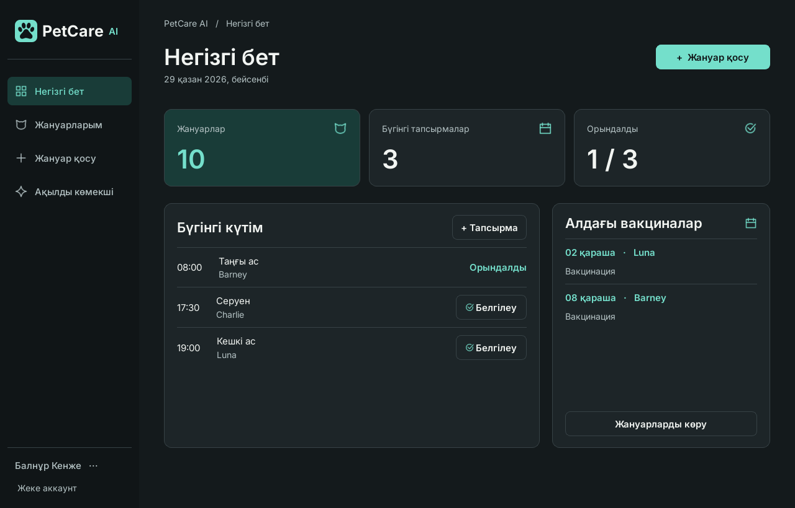
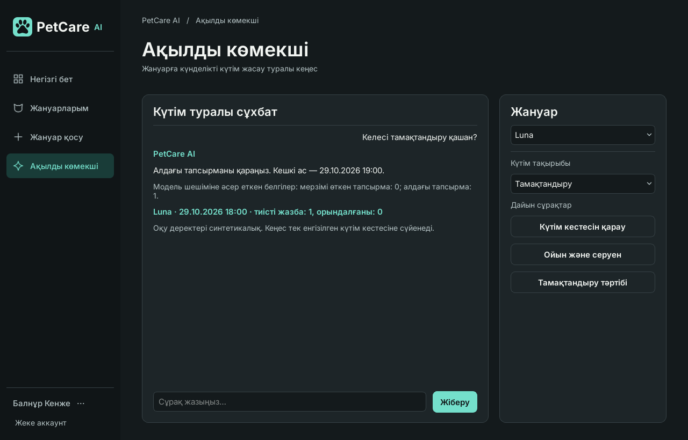

# PetCare AI

Үй жануарларын тіркеу, күтімді жоспарлау және жеке журналдан келесі әрекетті ұсыну үшін жасалған қазақша Windows қолданбасы. Бұл тармақ Кенже Балнұрдың деректер, интерфейс және ЖИ модулін қамтиды. Интерфейс [PetCare AI Desktop](https://www.figma.com/design/7mDGqaX9GiRE6OVNBaOMdI?node-id=6-3) макетіне негізделген.



## Windows-та іске қосу

Python 3.11 немесе 3.12 қажет. Репозиторийді алғаннан кейін PowerShell-де:

```powershell
git switch feature/balnur-data-adviser
py -3.12 -m venv .venv
.\.venv\Scripts\python.exe -m pip install -r requirements.txt
.\.venv\Scripts\python.exe -m petcare --demo
```

Python 3.11 орнатылса, бірінші Python командасына `py -3.11` қолданыңыз. Демо режимі жедел жадта ашылады: 10 жануар, көрсету күні 29.10.2026, уақыт 18:00. Демо жабылғанда өзгерістер жойылады. Жеке аккаунтпен тұрақты жұмыс істеу үшін `python -m petcare` командасын виртуалды ортада орындап, «Аккаунт ашу» батырмасын таңдаңыз. Дерек %LOCALAPPDATA%/PetCareAI/petcare.sqlite3 файлына жазылады. Басқа файл таңдау үшін `python -m petcare --db my-pets.sqlite3` қолданыңыз.

## Модульді тексеру

1. Демо тізімінде Luna-ны тауып, салмағын өңдеңіз. Жою терезесінде «Бас тарту» жазбаны сақтайды.
2. Басты беттен күтім тапсырмасын қосып, аяқталғанын белгілеңіз. Статистика автоматты түрде жаңарады.
3. «Ақылды көмекші» бөлімінде Luna мен тамақтандыру санатын таңдаңыз. Модель алдағы күтімді қарауды ұсынады; 19:00 уақытын қолданба Luna-ның «Кешкі ас» жазбасынан алады. Charlie-дің мерзімі өткен серуені және Moti-дің бос жоспары екі басқа шешімді көрсетеді.
4. Бүйір мәзірдің төменіндегі аккаунт батырмасында профиль, жоспарларды салыстыру, апталық статистика, тарих, CSV экспорт, пошта және шығу орналасқан. Деректер әр аккаунт бойынша оқшауланған.



## Балнұрдың жеке моделі

`petcare/ai/adviser/` ішінде оқыту және тексеру CSV-лері, train.py, болжам жасау коды және нақты үйретілген ағаштың model.json файлы бар. Ұсыныс санаты модельден, түсіндірмедегі тапсырманың атауы мен уақыты SQLite деректерінен алынады. Бұл оқу моделі күтімді ұйымдастыру әрекетін таңдайды. [Модель картасы](petcare/ai/adviser/model_card.md) · [Жеке тексеру нәтижелері](petcare/ai/adviser/evaluation.json)

```powershell
.\.venv\Scripts\python.exe -m petcare.ai.adviser.train
.\.venv\Scripts\python.exe -m pytest -q
```

Аружанның сұрақты жіктейтін жеке моделі бөлек тармаққа жоспарланған. Осы нұсқада сұрақтың санатын қолданушы таңдайды. Кейін `MainWindow(..., classify_intent=..., rank_plans=...)` арқылы ортақ чат пен жоспарларды салыстыруға қосуға болады. [Екі қатысушының жұмыс жоспары](TEAM_IMPLEMENTATION_PLAN.md)

## Деректер мен пошта

SQLite схемасы: `petcare/db/migrations/001_initial.sql`. Сеанс пен қалпына келтіру кодына мерзім/жарамдылық тексерістері қолданылады; құпиясөз тұздалған хеш ретінде сақталады. Автоматты тесттер нақты хат жібермей, хабарламаны жасау мен TLS көлігіне тапсыруды тексереді. Нақты пошта үшін процесс ортасына `PETCARE_SMTP_HOST`, `PETCARE_SMTP_FROM`, қажет болса `PETCARE_SMTP_USER` және `PETCARE_SMTP_PASSWORD` беріңіз. Әдепкі TLS режимі `starttls` (587), баламасы `PETCARE_SMTP_MODE=ssl` (465). Портты `PETCARE_SMTP_PORT` арқылы өзгертуге болады. Оларды репозиторийде сақтамаңыз.

Бумадағы Inter қарпімен бірге оның [OFL лицензиясы](petcare/ui/fonts/OFL.txt) берілген.

